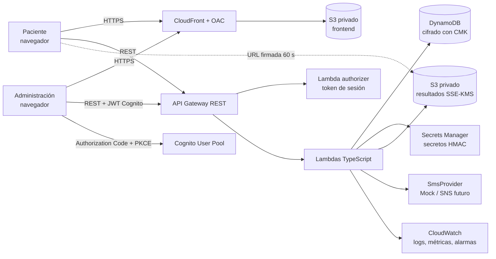

# Arquitectura

EIRA Resultados entrega resultados de Papanicolaou de forma digital, segura y trazable para EIRA Movimiento Rosa A.C.

> Estado: etapa 0 (estructura base). Este documento describe el diseño aprobado; los componentes se implementan por etapas.

## Componentes

| Capa           | Tecnología                                                                       |
| -------------- | -------------------------------------------------------------------------------- |
| Frontend       | React + TypeScript + Vite, CSS Modules; S3 privado + CloudFront con OAC          |
| API            | Amazon API Gateway (REST API)                                                    |
| Cómputo        | AWS Lambda, Node.js 24 (`nodejs24.x`, `arm64`), TypeScript compilado con esbuild |
| Datos          | Amazon DynamoDB (ver [data-model.md](data-model.md))                             |
| Documentos     | Amazon S3 privado con SSE-KMS                                                    |
| Auth admin     | Amazon Cognito, Authorization Code Flow con PKCE, MFA                            |
| IaC            | AWS SAM (`infrastructure/template.yaml`)                                         |
| Observabilidad | Amazon CloudWatch                                                                |

## Flujo de acceso de la paciente

1. La paciente envía nombre completo, fecha de nacimiento y folio.
2. El backend normaliza los datos, calcula HMAC con un secreto del servidor y verifica el expediente. Si no hay coincidencia, la respuesta es idéntica (anti-enumeración).
3. Si hay coincidencia, genera un PIN de 6 dígitos con `crypto.randomInt` y guarda solo `HMAC(secreto, challengeId:pin)`.
4. El PIN se envía por `SmsProvider` (`MockSmsProvider` en la demo; `AwsSnsSmsProvider` es una integración futura).
5. Vigencia de 5 minutos, máximo 5 intentos, reenvío a partir de los 60 segundos.
6. Validación de un solo uso mediante escrituras condicionales en DynamoDB.
7. Se crea una sesión con token opaco de 15 minutos. Solo se guarda su hash y puede revocarse.
8. El backend autoriza el resultado asociado al expediente de la sesión (el `patientId` nunca viene del cliente).
9. Se genera una URL firmada de S3 con vigencia de 60 segundos.
10. Cada paso queda registrado en la auditoría.

Los valores del flujo están centralizados en `packages/shared/src/securityPolicy.ts`.

## Controles de seguridad clave

- **Sin texto plano:** ni el PIN, ni el token de sesión, ni los secretos se almacenan o registran en claro. Los secretos HMAC viven en Secrets Manager.
- **`demoPin`:** solo existe con `Stage=demo` y cuando el backend confirma en ejecución que usa `MockSmsProvider`. Nunca se guarda en DynamoDB ni aparece en logs. La plantilla SAM impide esta configuración en producción ([ADR-0003](adr/0003-demo-pin.md)).
- **Documentos:** buckets privados, SSE-KMS, TLS obligatorio. El único camino de lectura es una URL firmada que emite el backend tras autorizar.
- **Mínimo privilegio:** un rol IAM por Lambda.
- **Auditoría:** `AuditLog` append-only a nivel de aplicación y permisos ([ADR-0004](adr/0004-auditlog-append-only.md)).
- **Datos:** el proyecto usa exclusivamente datos sintéticos.

## Restricciones vigentes

- No desplegar recursos en AWS ni ejecutar `sam deploy`.
- No solicitar ni almacenar credenciales.
- No implementar envío real de SMS.

## Decisiones

| ADR                                              | Tema                                            |
| ------------------------------------------------ | ----------------------------------------------- |
| [0001](adr/0001-monorepo-npm-workspaces.md)      | Monorepo con npm workspaces y herramientas base |
| [0002](adr/0002-api-rest-y-sesion-opaca.md)      | API REST y sesión de paciente con token opaco   |
| [0003](adr/0003-demo-pin.md)                     | Política de `demoPin`                           |
| [0004](adr/0004-auditlog-append-only.md)         | AuditLog append-only (alcance y límites)        |
| [0005](adr/0005-tablas-dynamodb.md)              | Tablas DynamoDB según patrones de acceso        |
| [0006](adr/0006-cognito-pkce.md)                 | Cognito con Authorization Code Flow + PKCE      |
| [0007](adr/0007-frontend-hosting-css-modules.md) | Hosting S3 + CloudFront OAC y CSS Modules       |
